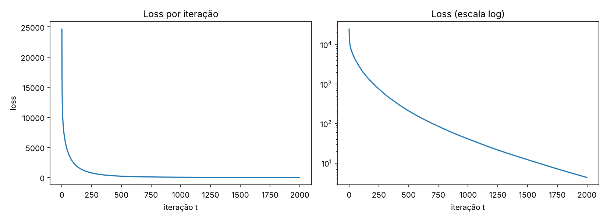

# Rede neural de 2 camadas em NumPy (CS231n – Lecture 4)

Reprodução e explicação da rede neural dos slides 30–34 da **Lecture 4** de
Fei-Fei Li, Yunzhu Li e Ruohan Gao (Stanford CS231n, 13/04/2023).
O slide mostra que treinar uma rede de 2 camadas "completa" cabe em ~20 linhas de NumPy.

## Arquivos

| Arquivo | O que é |
|---|---|
| `rede_neural_slide.py` | Código **idêntico ao slide** (20 linhas) |
| `rede_neural_completa.py` | Mesmo algoritmo + semente fixa, gráfico da loss e *gradient check* |
| `loss.png` | Curva da loss gerada pela versão completa |
| `requirements.txt` | Dependências (`numpy`, `matplotlib`) |

## Como rodar

```bash
pip install -r requirements.txt
python rede_neural_slide.py        # imprime "t loss" a cada iteração
python rede_neural_completa.py     # gradient check + treino + loss.png
```

## O código, bloco a bloco

### 1. Define the network (slide 31, linhas 4–6)

```python
N, D_in, H, D_out = 64, 1000, 100, 10
x, y = randn(N, D_in), randn(N, D_out)
w1, w2 = randn(D_in, H), randn(H, D_out)
```

- `N = 64`: tamanho do lote (64 exemplos).
- `D_in = 1000`: entradas por exemplo; `H = 100`: neurônios da camada oculta; `D_out = 10`: saídas.
- `x` e `y` são **dados aleatórios** (não há tarefa real). O objetivo é só mostrar o mecanismo de treino.
- `w1` (1000×100) e `w2` (100×10) são os pesos, inicializados com `randn`.
  Não há bias.

### 2. Forward pass (slide 32, linhas 9–11)

```python
h = 1 / (1 + np.exp(-x.dot(w1)))
y_pred = h.dot(w2)
loss = np.square(y_pred - y).sum()
```

- `x.dot(w1)` (64×100) é a combinação linear da entrada; a **sigmoide** `σ(z) = 1/(1+e^{-z})`
  é a não linearidade, e `h` é a ativação da camada oculta.
- `y_pred = h·w2` é a saída, **linear** (sem ativação na saída).
- A loss é o **erro quadrático** somado sobre todos os exemplos e saídas:
  `L = Σ (y_pred − y)²`.

### 3. Calculate the analytical gradients (slide 33, linhas 14–17)

É a **backpropagation** escrita à mão, aplicando a regra da cadeia de trás para frente:

```python
grad_y_pred = 2.0 * (y_pred - y)               # dL/dy_pred
grad_w2 = h.T.dot(grad_y_pred)                 # dL/dw2
grad_h = grad_y_pred.dot(w2.T)                 # dL/dh
grad_w1 = x.T.dot(grad_h * h * (1 - h))        # dL/dw1
```

| Linha | Derivação |
|---|---|
| `grad_y_pred` | `L = Σ(y_pred−y)²` ⇒ `∂L/∂y_pred = 2(y_pred−y)` |
| `grad_w2` | `y_pred = h·w2` ⇒ `∂L/∂w2 = hᵀ · ∂L/∂y_pred` |
| `grad_h` | `∂L/∂h = ∂L/∂y_pred · w2ᵀ` |
| `grad_w1` | `σ'(z) = σ(z)(1−σ(z)) = h(1−h)`, então `∂L/∂z = ∂L/∂h ⊙ h(1−h)` e `∂L/∂w1 = xᵀ · ∂L/∂z` |

Os `.T` e a ordem das multiplicações vêm das dimensões: o gradiente de cada peso
precisa ter o mesmo formato do peso (`grad_w1` é 1000×100, `grad_w2` é 100×10).

### 4. Gradient descent (slide 34, linhas 19–20)

```python
w1 -= 1e-4 * grad_w1
w2 -= 1e-4 * grad_w2
```

Cada peso anda um pouco na direção **oposta** ao gradiente (a direção que mais reduz a loss).
`1e-4` é a **taxa de aprendizado**. O laço roda 2000 vezes (`for t in range(2000)`).

## Resultados

Com semente fixa (`np.random.seed(0)`):

| Iteração | Loss |
|---|---|
| 0 | ≈ 24 636 |
| 100 | ≈ 2 383 |
| 500 | ≈ 211 |
| 1000 | ≈ 41 |
| 1999 | ≈ 4,35 |



A loss cai rápido no início e depois mais devagar (a escala log fica quase linear).
Ela não chega a zero em 2000 passos, mas continuaria caindo.

### Por que a loss cai tanto se os dados são aleatórios?

Porque a rede tem 1000×100 + 100×10 = **101 000 parâmetros** para ajustar apenas
64×10 = **640 valores de saída**. Ela tem capacidade de sobra e acaba **memorizando**
o lote (overfitting). Num problema real, o que importa é a generalização em dados novos.

### Verificação dos gradientes (gradient check)

`rede_neural_completa.py` compara o gradiente analítico com o numérico,
`(L(w+ε) − L(w−ε)) / 2ε`, em pesos escolhidos aleatoriamente. O erro relativo ficou
entre ~1e-11 e ~1e-8, o que confirma que as fórmulas do slide estão corretas.

## Observações

- A sigmoide satura (gradiente ≈ 0 para |z| grande), o que pode deixar o treino lento.
  Por isso a taxa de aprendizado é pequena e são necessárias muitas iterações.
- Não há bias, regularização, mini-batches nem otimizador sofisticado: é o treino
  mais simples possível, de propósito, para o slide ficar didático.

## Referência

Fei-Fei Li, Yunzhu Li, Ruohan Gao. *CS231n – Lecture 4: Backpropagation and Neural Networks*, slides 30–34, 2023.
